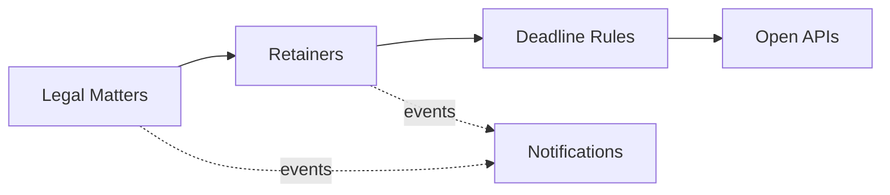

# Domain Model and Bounded Contexts

Ubiquitous language and context design (view VP-4). Domain-standard concepts are mapped
normatively in `../domain/domain-standards.md` (CR-5).

## Ubiquitous language (selected terms)

| Term | Meaning |
|---|---|
| **Legal matter** | A litigation, corporate, labor or family matter; the client reference is masked |
| **Retainer account** | A matter's guarded client-funds balance, in minor units |
| **Time charge** | One charge against the retainer, by activity type |
| **Deadline rule** | A decision rule binding a matter type to filing-window and extension envelopes |
| **Legal document** | A catalogued document (contract, brief, filing, opinion) — metadata only |
| **Matter risk score** | A transparent 0-100 deadline/conflict risk score |

## Bounded contexts and invariants

### Legal Matters — `matter-service`
Matter registry; the client reference is masked at intake. Lifecycle: `OPEN` → transitions
suspend, close. Client references are validated at intake and never stored or returned in clear — only a masked form is kept. Matter content and documents' contents are never stored by this core (metadata only); all data is synthetic. Attorney–client privilege boundaries are adopters' professional duty.

### Retainers — `retainer-service`
Guarded retainer balances per matter and the time charges against them. **Invariant (ADR-0004): charges against a matter's retainer never exceed the retainer balance — a charge that would overrun it is rejected (422) and records nothing; client funds accounting is always exact.** Consumption records are
append-only evidence; a rejected operation records nothing.

### Deadline Rules — `deadline-rules-service`
Decision rules binding matter types to filing-window and extension envelopes. Only ACTIVE rules decide; evaluation order is by priority; every decision
is ALLOWED / DEGRADED / DENIED with the matched rule and a human-readable reason.

### Legal Documents — `document-catalog-service`
Document catalogue — metadata only, never content.

### Notifications — `notification-service`
Delivery trail for audit; recipients are never logged.

## Context map

